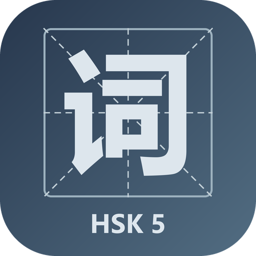

# HSK Platform · HSK 1–6

A personal Chinese-learning platform covering HSK levels 1–6 in a single, offline-capable web page.

**Open the app:** `index.html` (or the GitHub Pages site for this repository). No server, no login — progress is stored in your browser; use *Settings → Export progress* to back it up or move it to another device.



## What it does

One app, one learning engine, six independent level databases (`data/hsk1.json` … `data/hsk6.json`). Each level has its own progress, exam date, plan, mock-exam settings and history; level sessions and mock exams never mix levels (only the explicit *Cross-level review* does).

Per level:

- **Overview** — studied / mastered / due / mistakes, exam countdown and “what to do next”
- **Characters** — study groups of 10, component families, colour-coded grid
- **Frequency** — characters ranked by how many words of the level use them + general corpus frequency
- **Vocabulary** — priority-ordered batches (learn cards → exercises), searchable word list
- **Flashcards** — self-graded (Again / Hard / Good / Easy)
- **Review** — spaced repetition (Leitner boxes: 1, 2, 4, 7, 15, 30, 60 days) and a mistakes list
- **Practice** — custom sets, random recall (typed pinyin + meaning), final review
- **Mock exams** — timed HSK-style papers (listening, reading, sentence ordering, pinyin), scoring and history
- **Progress** — status breakdown, daily activity, accuracy by exercise type, mock scores
- **Exam prep** — exam date → remaining workload, daily pace, priorities and a mock schedule that adapts when you fall behind

Exercise types: meaning, choose the word, fill in the blank, sentence meaning, sentence order, choose pinyin, type pinyin (tone marks or numbers; `ü` as `ü`/`v`/`u:`), listening (word / sentence, if the device has a Chinese voice), word-with-character.

## Data

| Level | Syllabus / source | Words | Characters |
|---|---|---|---|
| 1 | HSK 2.0 list (MandarinBean) | 150 | 174 |
| 2 | “New HSK” list (MandarinBean) | 198 | 200 |
| 3 | “New HSK” list (MandarinBean) | 499 | 480 |
| 4 | HSK 2.0 list (MandarinBean) | 600 | 716 |
| 5 | HSK 2.0 list (HanziStroke, cross-checked with MandarinBean) | 1301 | 1207 |
| 6 | “New HSK” list (MandarinBean) | 1794 | 1342 |

Note that the supplied lists come from two different syllabuses, so some words appear in more than one level (see `levels_report.txt`). Example sentences were written for this app using only vocabulary from the same level or below. Character meanings and components come from CC-CEDICT (CC BY-SA 4.0) via hanzipy; character frequency from Jun Da's corpus list.

## Building

`index.html` is generated. Sources live in `build/`:

```
python build/build_levels.py .          # data/hsk1..6.json from the parsed lists + authored files
python build/build_app.py build data index.html
```

(Requires Python with `jieba`, `pypinyin`, `hanzipy`. The raw text extracted from the original PDFs is not included in this repository.)
